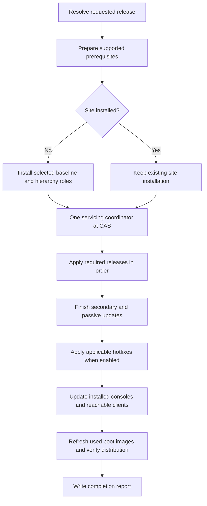

# Selecting and servicing an SCCM lab release

The deployment code is written and connected to `new-config.yml`. Windows offline checks pass. Ansible execution, media extraction, and live deployment still need testing on a Linux Ludus host. Follow the [host handoff](LUDUS_HOST_HANDOFF.md) before calling this release validated. The [full plan](../UPGRADE_PLAN.md) records the agreed scope.

## Choose the result

Edit the shared settings on the first VM in `new-config.yml`:

```yaml
role_vars: &sccm_version_settings
  ludus_sccm_target_version: "latest"
  ludus_sccm_install_hotfixes: true
```

Keep the `ludus_sccm_component_hosts` list below those settings. Every other VM merges the shared settings using `<<: *sccm_version_settings`. Change the two values once, keeping release numbers quoted. For example, `"2509"` and `false` select 2509 without adding optional hotfixes. False never removes an installed fix or a fix bundled into installation media.

| Selection | Fresh installation | Existing installation |
| --- | --- | --- |
| `"2403"` | 2403 baseline | Verify 2403; refuse a downgrade |
| `"2409"` | 2403, then 2409 | Follow the permitted release route |
| `"2503"` | 2403, then 2503 | Follow the permitted release route |
| `"2509"` | 2509 baseline | Update from 2403 or later |
| `"2603"` | 2509, then 2603 | From the observed 2403 lab: 2509, then 2603 |
| `"latest"` | Resolve Microsoft's broad release, then choose baseline and route | Resolve the same way, then use actual site versions |

On October 22, 2026, Microsoft's documentation identified 2603 as globally available and 2609 as early release. These are dated observations. The planner rejects an unknown future release until its installation path and prerequisites have been reviewed. Unreadable or ambiguous release evidence stops planning instead of silently selecting an older release. Explicit historical selections work without release-document internet access, although installation still needs downloads.

## Problem, solution, and alternatives

Previously the roles downloaded 2403 and could stop after starting installation. The new code distinguishes the requested final release, installation media, installed site versions, and finished component updates. Microsoft Learn proves broad availability; SCCM's normal servicing catalog supplies applicable updates. The highest update currently visible to an old site does not establish the latest release it can eventually reach.

A fixed latest release would contradict automatic selection. Guessing from a release date could select an early release. Reinstalling an existing site would discard lab state. Those approaches were rejected. The chosen approach keeps the installation roles and adds one coordinating servicing role.



## Where the behavior lives

| File or role | Responsibility |
| --- | --- |
| `plugins/module_utils/sccm_versions.py` | Read release evidence, reject invalid selections and downgrades, choose supported update routes |
| `plugins/module_utils/sccm_deployment.py` | Baseline URLs, prerequisite downloads, release build numbers |
| `plugins/action/sccm_version_plan.py` | Run planning on the controller; Windows does not need Python |
| `roles/sccm_common` | Share the selection during an Ansible invocation, download files, provide Windows helpers |
| `roles/prepare_sccm` | Install and verify ODBC, Visual C++, and, where needed, ADK and WinPE; restart when required |
| `roles/prep_siteserver/tasks/media.yml` | Download/extract versioned media; verify Microsoft signatures and embedded setup build |
| `roles/install_primary_site` | Use selected media for fresh setup; an installed-site registry value keeps existing sites out of fresh-install retry/uninstall handling |
| `roles/install_secondary_site/tasks/verify.yml` | Wait for active provider state, installed version, and running SMS Executive |
| `roles/install_passive_site_server/tasks/verify.yml` | Wait for completed HA preparation, prerequisites, installation, post-installation, and installed version; never request promotion |
| `roles/service_hierarchy/tasks/main.yml` | Read actual versions, plan remaining work, run updates and final checks, fetch evidence even on failure |
| `roles/service_hierarchy/files/Update-SccmRelease.ps1` | Start or rejoin release updates at the root; save recovery material, finish secondaries/passive servers, wait for replication |
| `roles/service_hierarchy/files/Update-SccmHotfixes.ps1` | Apply registered applicable unsuperseded fixes and refresh after each update |
| `roles/service_hierarchy/files/Complete-SccmDeployment.ps1` | Verify sites/roles/providers; update installed consoles/clients; refresh distributed boot images; save the report |
| `roles/sccm_common/files/SccmDeployment.psm1` | Shared prerequisite, update-state, SQL, readiness, logging, and bounded-wait operations |

The secondary installation fallback now recognizes site type 1. The passive installation check recognizes the actual `SMS Site Server` role and uses a valid WMI namespace. Existing submission status files remain, but role success now also requires final readiness checks.

## Prerequisites, media, and recovery

The understood releases currently share ODBC 18.6.2.1, ADK 10.1.26100.9457 and the supported 26100 WinPE add-on. These replace old incompatible packages. Registry inventory avoids `Win32_Product`, which can repair software just by querying it. .NET Framework 4.8 is checked, not installed automatically. ADK preparation runs on site servers and SMS Provider hosts. ODBC preparation also runs on database and management-point hosts.

Dedicated lab SQL databases and the SQL template database use compatibility 150 during baseline/intermediate installation. CAS/PS1 retain their existing SQL engines. The secondary's named SQL 2016 Express instance is backed up, patched to SP3, then upgraded to SQL 2022 Express using its parent's 2509-or-newer CD.Latest files. This may restart the secondary. Existing SQL 2017-or-newer instances are retained. Historical parents lacking newer Express media require an owner-managed SQL upgrade if needed. SCCM setup checks remain authoritative.

Before a new SCCM update, the code checks site active state, at least 50 GB free on site-server system disks, pending Windows update/CBS restart state, and replication readiness. It creates SQL COPY_ONLY backups with checksums and runs RESTORE VERIFYONLY. SQL backups remain in each SQL host's configured backup directory. CAS/primary CD.Latest copies go under `C:\ludus\sccm\recovery\<site>\<version>`. These checks supplement SCCM prerequisite checks and an agreed coordinated recovery point; they do not prove a full recovery restore.

Versioned cache files live under `/opt/ludus/resources/sccm`, and guest media under `C:\ludus\sccm\media\<baseline>`. Optional `ludus_sccm_media_url` and `ludus_sccm_media_checksum` settings override the chosen baseline download. A checksum uses Ansible's `sha256:<hex>` form. Overrides still require valid Microsoft signatures and the expected setup build. Remove a damaged cached download before retrying. The existing installation roles still assume the default Windows work directory; changing `ludus_sccm_work_directory` across the whole lab is not supported in this change.

## Updates, retries, and completion

One root coordinator waits for CAS expansion, provider installation, passive installation, and secondary installation. For a standalone primary, place `mayyhem.ludus_sccm.service_hierarchy` after all role-installation work and set `ludus_sccm_sitecode` to that primary's code.

The coordinator reads actual versions. It can plan from the oldest site in an interrupted hierarchy, but refuses a different running update. A matching active update is observed without another setup request. Failed update states require correcting the cause and using the console's supported retry. No database state reset is performed. An SCCM update that requires a site-server restart stops; restart the affected server and rerun. Fresh-install retries remain separate from servicing.

Prerequisite errors always stop. Warnings stop by default. After examining ConfigMgrPrereq.log, an owner can set `ludus_sccm_allow_prerequisite_warnings: true` in the shared settings. This permits warnings only and never skips errors.

The hotfix switch covers fixes registered in SCCM servicing, including already imported fixes. It does not download arbitrary out-of-band hotfix tools or import every KB mentioned online. Supersedence only hides a fix when its replacement is available. Two scans without an eligible fix finish discovery; live testing must verify synchronization timing.

Final checks require all site versions to match the chosen root release/revision, healthy summarized MP/DP/site-server state, current provider builds, and passive readiness. Console versions come from the site's advertised console version. Client versions come from the assigned primary's production MSI; they need not equal the site version. Source files are copied to each endpoint before execution, avoiding credentials forwarded to a third host. A console/client newer than the selected source produces a failure instead of a downgrade.

Registered nonobsolete clients, site systems, and `ludus_sccm_component_hosts` are inspected. The sample list includes ps1-dev so consoles are found before client discovery. Machines without a client/console are not given one. Unreachable management endpoints are listed separately. Unreachable site systems and reachable component failures prevent completion. WinRM availability defines whether endpoint operations can run.

Distributed boot images are reloaded through the supported distribution-point command. All assigned distribution points must report the new source version installed. Undistributed images are logged and skipped. A saved journal lets a successful rerun verify images without rebuilding them again. Unsupported old custom images may need owner repair before reload succeeds.

## Read the results

The root server writes logs and JSON under `C:\ludus\sccm`:

- `hierarchy-update.log`: release/hotfix progress.
- `deployment-verification.log`: final component work and failures.
- `deployment-report.json`: completion, versions, endpoints, and failures.
- `database-backups.json` and `hotfix-database-backups.json`: SQL backup locations.
- `boot-image-journal.json`: completed image refreshes.

Ansible fetches root logs/reports to `/opt/ludus/resources/sccm/reports/<range_id>/<inventory_hostname>/`. A failed fetch remains visible and does not replace the original failure. Prerequisite/readiness logs remain on their respective guests. SQL backups and recovery media are not automatically copied to the controller.

`Complete: true` describes these component checks. Independently test console access, client policy/inventory, content delivery, PXE, and collector behavior after a live deployment. Microsoft's 2603 changes to Network Access Account information can change research/collector results.

## Dependencies and validation status

No new Python runtime package, extraction utility, Ansible collection, or PowerShell module is added. Existing Ansible Windows/AD collections remain required. Microsoft installers carry their own terms. This lab collection already uses GPL-3.0-or-later. Offline YAML validation uses PyYAML 6.0.3 (MIT); Ruff 0.17.1 and ty 0.0.90 (MIT) are validation tools only.

Local Windows validation on October 22, 2026: 40 Python unit tests and 22 PowerShell behavior checks passed. YAML/module-help parsing, PowerShell parsing, focused Python lint/format/type checks and `git diff --check` passed. The handoff has exact commands and remaining checks. Ansible build/syntax/integration, vendor installers, and live upgrades have not run. No lab upgrade, staging, commit, or push was performed.

Important sources:

- [Release/baseline versions](https://learn.microsoft.com/en-us/intune/configmgr/core/servers/manage/updates)
- [2509 checklist](https://learn.microsoft.com/en-us/intune/configmgr/core/servers/manage/checklist-for-installing-update-2509)
- [2603 checklist](https://learn.microsoft.com/en-us/intune/configmgr/core/servers/manage/checklist-for-installing-update-2603)
- [ADK support](https://learn.microsoft.com/en-us/intune/configmgr/core/plan-design/configs/support-for-windows-adk)
- [Prerequisite checks](https://learn.microsoft.com/en-us/intune/configmgr/core/servers/deploy/install/list-of-prerequisite-checks)
- [Update states](https://learn.microsoft.com/en-us/troubleshoot/mem/configmgr/setup-migrate-backup-recovery/understand-troubleshoot-updates-servicing)
- [Client installer arguments/exit codes](https://learn.microsoft.com/en-us/intune/configmgr/core/clients/deploy/about-client-installation-properties)
- [SQL upgrade paths](https://learn.microsoft.com/en-us/sql/database-engine/install-windows/supported-version-and-edition-upgrades-2022?view=sql-server-ver16)
- [Ludus CLI](https://docs.ludus.cloud/docs/cli)
